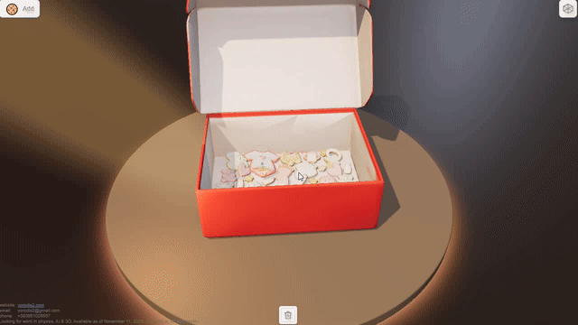

# Cookies — 3D Physics Demo 🍪

An interactive browser demo of cookies and a gift box, built with Three.js and OimoPhysics.

**[Try the live demo](https://vorodis2.com/_cookies/)**



## About

This prototype started with an Upwork job post about fitting custom cookie shapes efficiently into rectangular gift boxes. I decided to build a visual demo to include with my proposal.

I reused the scene and physics foundation from my Pyramid demo, replaced the objects with cookies and a gift box, and put together an interactive physics scene.

This is a physics prototype. It does not implement an optimal 2D nesting or packing algorithm.

## From reference image to interactive demo

1. Used the cookie reference image from the client's job post.
2. Asked ChatGPT to remove the box and space the cookies apart for 3D generation.
3. Generated cookie and box models with [Tencent Hunyuan 3D](https://3d.hunyuan.tencent.com/).
4. Used ChatGPT to help refine the generated assets.
5. Made additional manual adjustments in Blender.
6. Integrated the models into the existing scene with AI coding assistance and prepared physics colliders.

## Highlights

- Cookies of different shapes interacting with the box and each other.
- An interactive scene with a movable camera.
- Physics collider visualization for inspecting collision geometry.
- A workflow combining existing code, AI-generated assets, and manual editing.

## Tools

- Three.js — browser-based 3D rendering.
- OimoPhysics — rigid-body simulation.
- Blender — manual model adjustments.
- Tencent Hunyuan 3D — model generation from images.
- ChatGPT and AI coding tools — image preparation, asset refinement, and integration assistance.

## Run locally

```sh
git clone https://github.com/vorodis2/_cookies.git
cd _cookies/www
npm install
npm run dev
```

Open the URL printed by Vite and navigate to `/div.html` to view the demo scene.

## Production build

From the `www` directory:

```sh
npm run build
npm run preview
```

The build output is written to `www/dist`. Deploy its complete contents to a static web host. Relative asset paths support deployment in a subdirectory.

## Author

Yevhen Sidorov — 3D web developer working with interactive graphics, physics, and simulations.

[Portfolio](https://vorodis2.com/) · [GitHub](https://github.com/vorodis2)

## Asset provenance

The cookie reference image came from the client's job post. The 3D assets were generated from reference images and subsequently refined. This README does not grant rights to the original reference image or third-party assets.
